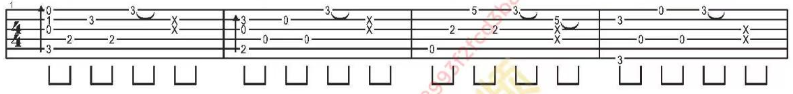

# 前四小节：六线谱图片识别过程

用《不是因为寂寞才想你》小声指弹版第一页前四小节，说明从图片到可编辑六线谱的处理过程，以及识别错误怎样留痕。示例保留未校订结果，供对照分析。

## 范围与来源

- 仅第 1–4 小节、一行六线谱；不包含整页和后续小节。
- 来源是用户提供的谱面，原图标有“小声指弹”；曲作者与具体编配署名未在所用图中明确，不作推定。
- 原图有版权保留及不可传播说明。本例按用户指定范围作识别技术分析引用，**授权状态尚未核实，四小节不构成自动免责**，也不授予引用乐谱的再传播或商业利用许可。
- 原图尺寸、裁剪坐标、原图哈希、片段哈希与来源说明见 [source.json](source.json)。公开输入仅为 [input.png](input.png)，无须取得整谱即可复现程序过程。

## 1. 选取识别输入



从 1280 × 1811 原图按 `[52, 362, 1228, 503]` 裁出 1176 × 141 图片，保留六根弦、音符及下方节奏符号，不含曲名、速度、Capo 的谱头。没有对音符或水印做擦除、重绘或锐化。裁剪图本身作为可复现输入保存。

坐标约定是左、上、右、下像素，右、下边界不包含在裁剪内。这里的四小节恰好是一整行，因此不需要拼接或补齐小节。

## 2. 明确人工参数

[plan.json](plan.json) 记录以下参数，不能把它们算作自动识别成功项：

| 参数 | 值与依据 |
| --- | --- |
| 速度 | 80，取自原谱谱头 |
| 拍号 | 4/4，取自原谱 |
| 调弦 | 第 1–6 弦 E4、B3、G3、D3、A2、E2；原图未注明特殊调弦，暂按标准吉他处理 |
| Capo | 第 5 品，取自原谱谱头；派生工程仅保留文字，播放不移调 |
| 识别范围 | 一个谱行、四小节，脚本检查此数量 |

计划中的 `source: input.png` 相对本示例目录解释。[reproduce.py](reproduce.py) 把它复制到被 Git 忽略的本地临时输入，再调用通用脚本，不读取整首曲谱。

## 3. 调用识别器并保留原始输出

PDF-to-GP5 0.9.0 固定提交 `4754a207ff4a08be8dfb4b5097c4a4c3775004d4`，运行于根 `.venv`。固定 Python 依赖见根 `requirements.txt`，实际版本摘要见 [result.json](result.json)。上游识别器未改动。

| 文件 | 用来观察什么 |
| --- | --- |
| [原始 GP5](recognition/recognized.gp5) | 识别器直接生成的吉他谱 |
| [工具报告](recognition/conversion.json) | 符号计数、节奏来源和警告 |
| [事件 JSON](recognition/events.json) | 重新读取 GP5 得到的逐小节时值、弦号、品位和闷音/延音类型 |
| [文本六线谱](recognition/preview.txt) | 快速对照识别器的符号预览 |

本次报告为 4 小节、29 个新音符/闷音符号，各小节分别为 10、8、5、6。这个计数不包含全部延音元素，也不是准确率。

## 4. 分析结果，保留错误

工具报告仅第 3 小节的节奏来自记谱符号，第 1、2、4 小节由音符间距估算。原始事件的时值序列如下，以四分音符为 1：

| 小节 | 事件时值序列 | 解释 |
| --- | --- | --- |
| 1 | `0.5, 0.5, 0.5, 0.5, 1, 1` | 节奏估算，需对照原图的连线和节奏杆 |
| 2 | `0.5, 0.5, 0.5, 0.5, 1, 1` | 节奏估算，需核对闷音与延音 |
| 3 | 八个 `0.5` | 工具称从符号读取；仍存在内容缺失 |
| 4 | `0.5, 0.5, 0.5, 0.5, 2` | 节奏估算，不能直接当作校订时值 |

原图第 3 小节末段有 `x` 闷音，但该小节原始 `events.json` 中没有 `dead` 类型音符。这是可以直接对照的漏识别例子，说明小节数相同、能播放、能导出都不能替代内容核对。本例没有人工补入这些闷音，也没有把估算节奏改成手工参考答案。

## 5. 设置 TAB 谱表并导出

通用脚本按顺序整理 GP5，省略音符/拍效果和反复语义；基本弦位、品位、闷音与识别时值保留，延音品位按前面同弦音符统一。通过 Flatpak 命令行调用 MuseScore 4.7.5，设置六线谱谱表并导出：

- [MusicXML](export/opening.musicxml)：结构化交换文件。
- [MuseScore 工程](export/opening.mscz)：可以继续编辑六线谱。
- [PDF](export/opening.pdf)：一页四小节预览。
- [整理后的 GP5](export/opening.gp5)：便于比较原始识别与导出起点。

MusicXML 含 4 个小节、32 个 `note` 元素（包括延音），不能与 29 个新符号直接比较。检查覆盖 TAB 谱表和逐小节弦号/品位多重集合；它验证格式转换保留情况，不验证识别准确性。

## 自行复现

先按 [环境说明](../../../doc/ENVIRONMENT.md) 准备 `.venv`、依赖和 MuseScore，再从项目根目录运行：

```bash
.venv/bin/python examples/tablature-recognition/bushiyinweijimocaixiangni-opening/reproduce.py \
  score/bushiyinweijimocaixiangni/recognition/user-provided/pdf-to-gp5/opening-reproduction
```

输出目录须尚不存在，重复运行会拒绝覆盖。运行日志、环境清单和所有生成物保存在被 Git 忽略的本地输出目录；示例中的公开快照不会自动改写。结果不保证字节完全相同，尤其 MSCZ/PDF 可能携带生成时间或内部标识，应比较小节、弦位、品位与节奏数据。

## 文件维护与公开边界

本例是精确文件清单登记的四小节例外，规则见 [示例规范](../../README.md)。不添加原始整页、其余小节、完整工程、完整转录或私有运行清单。公开记录只保留本片段所需的过程与版本信息，不含本机用户目录。
